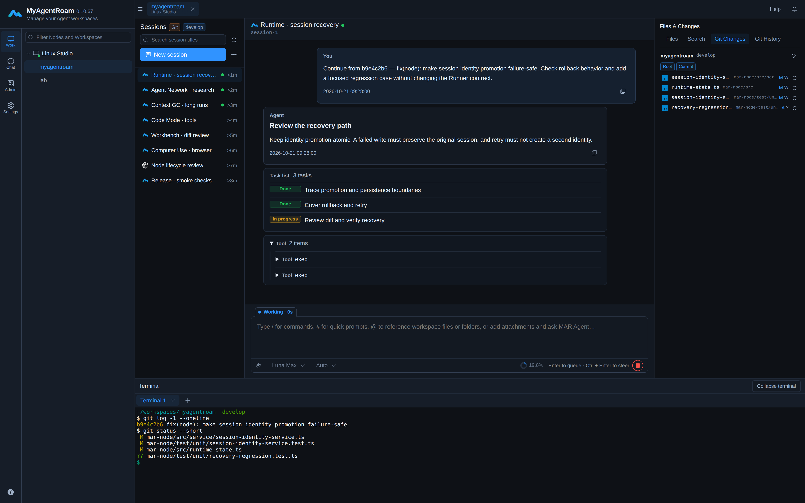
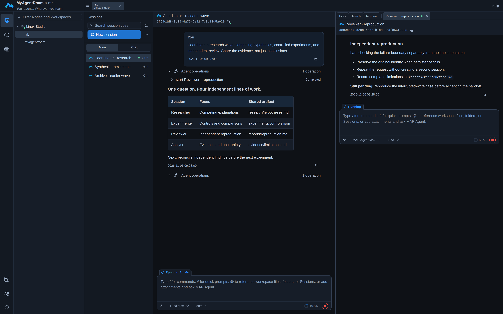
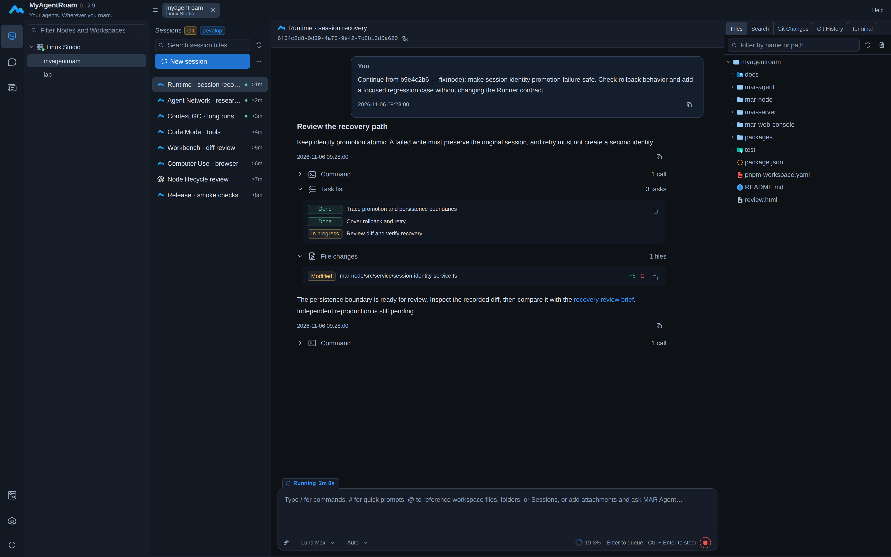

<p align="center">
  
</p>
<h1 align="center">MyAgentRoam</h1>
<p align="center"><strong>Agent First. Work Anywhere.</strong></p>
<p align="center">A self-hosted Agent workbench. Execution on your machines. Direction from your desktop or phone.</p>
<p align="center"><strong>MAR Agent · Codex · Claude Code · OpenCode</strong></p>
<p align="center">
  <a href="#get-started">Get started</a> ·
  <a href="#agent-first">Agent First</a> ·
  <a href="#work-anywhere">Work Anywhere</a> ·
  <a href="#agent-network">Agent Network</a> ·
  <a href="docs/help/en-US/getting-started/overview.md">Documentation</a> ·
  <a href="README.zh-CN.md">简体中文</a>
</p>
<p align="center"><sub>Apache-2.0 core · source-available product/EE · <a href="LICENSING.md">Exact licensing scope</a></sub></p>

<p align="center">
  
</p>



## Agent First

**Not an IDE with an AI sidebar. A workbench built around Agent execution.**

The Agent is the primary worker. Your browser is where you **set direction, steer execution, and review the result** — with the project's files, Git, and terminal right beside the conversation.

People define goals and constraints, make key decisions, and review outcomes. Agents carry out authorized work using the project's real tools and environment. **Agent First does not mean permission-free execution or skipping human judgment.**

> **Set direction → Let Agents work → Inspect evidence → Refine and continue**

## Work Anywhere

**Your phone is a way to stay involved, not a development machine you need to configure.** Agents run on your work Nodes; your browser is where you check progress, send guidance, and review results. Mobile access is part of the design, not an afterthought: work should not require sitting in front of the machine doing the execution.

Closing the browser or putting it in the background does not automatically stop an active session on the Node. Use your phone for progress, notifications, files, and short replies; keep complex diffs and long terminal work on desktop. Anywhere access requires connectivity to your self-hosted Server and the relevant Node to be online for live work — it is not offline execution. [Continue from mobile](docs/help/en-US/workbench/mobile.md).

## Built for more than a single prompt

<table>
<tr>
<td width="50%"><strong>Real projects. Real tools.</strong><br />Work in an existing Workspace with its files, dependencies, Git history, and shell. No copy-and-paste development environment.</td>
<td width="50%"><strong>Multiple Agents. One workbench.</strong><br />MAR Agent, Codex, Claude Code, and OpenCode share one interface for history, live output, and the controls each Runner supports.</td>
</tr>
<tr>
<td><strong>Built for sustained work</strong><br />Context GC, Smart Compaction, steer, queues, Code Mode, and subagents help MAR Agent continue beyond a single prompt.</td>
<td><strong>Steer without starting over</strong><br />Add guidance during execution, queue follow-up work, inspect tool activity, or stop and reassess. Controls follow the selected Runner's capabilities.</td>
</tr>
<tr>
<td><strong>Agent Network</strong><br />Coordinate independent sessions for research, implementation, and review. Share artifacts, exchange handoffs, and inspect results through marctl.</td>
<td><strong>Tools and spaces you can reuse</strong><br />Configure models, Skills, and MCP. Start isolated template-based conversations with attachments and deliverable artifacts.</td>
</tr>
<tr>
<td><strong>Your work machines, within reach</strong><br />Use authorized Nodes from a desktop or mobile browser without recreating the project environment on every device. Windows / Linux / macOS.</td>
<td><strong>Goals and recurring work</strong><br />Use Goal mode for multi-turn continuation, or schedule a session for recurring tasks. Review their permission and execution rules before enabling unattended work.</td>
</tr>
</table>

### Context GC and context management

- **Context GC:** reclaim eligible historical context incrementally so long-running work does not carry every old detail into every model request.
- **Smart Compaction:** let MAR Agent request background compaction at a suitable work-phase transition; fixed capacity protection remains independent.
- **Visible context:** inspect reported context usage, compaction status, and plans, with a manual Compact entry when needed. These mechanisms do not promise unlimited, lossless memory.

### Keep momentum. Keep the work reviewable.

- **Compose tool work:** with Code Mode enabled, MAR Agent can combine permitted tool calls in JavaScript and return selected results, reducing intermediate model round trips.
- **Follow the process:** inspect context usage, plans, tool output, file changes, and terminal activity rather than relying only on an Agent's final summary.
- **Continue deliberately:** queues, steer, Goal mode, and schedules offer different ways to move work forward. Goal mode changes queue and permission behavior; scheduled runs automatically approve tool permission requests. Use them only within a scope you trust.

[Context and plans](docs/help/en-US/workbench/context-and-plan.md) · [Steer, queues, and Goal](docs/help/en-US/workbench/composer.md) · [Scheduled sessions](docs/help/en-US/workbench/sessions.md) · [Code Mode and tools](docs/help/en-US/runners/mar-agent.md)

## Agent Network

**One question. Multiple independent sessions. A shared body of evidence.**

Use a coordinator to distribute work, researchers to explore alternatives, and a separate reviewer to challenge results. Sessions work in the same authorized Workspace, exchanging messages and artifacts through the existing MAR environment.



_User-defined session roles coordinate work; Agent Network is not a separate orchestration dashboard._

- **Independent sessions** retain their own context and can be revisited across research waves.
- **Explicit handoffs** carry the question, scope, and artifact to inspect; a received message is not proof of completion.
- **Reviewable work** stays in shared files and visible session histories. Concurrent writers still need non-overlapping scopes.

Agent Network uses **marctl session coordination**. It is distinct from MAR Agent's bounded, non-recursive **subagents** inside one parent execution; neither implies automatic task ownership or a workflow engine. [Coordinate Workspace Sessions](docs/help/en-US/operations/marctl.md#coordinate-workspace-sessions).

## MAR Agent, inside the workbench or on its own

**Context GC · Smart Compaction · Steer · Code Mode · Subagents · Auto · Skills / MCP**

MAR Agent provides incremental Context GC, session continuation, planning, Skills, MCP, and non-recursive subagents. Its SDK and CLI can also be used independently of Server.

The SDK, CLI, and workbench share the same MAR Agent core. Smart Compaction is a **Community capability**, not an Enterprise-only feature. Fixed capacity protection remains independent of model-requested compaction. [Configure MAR Agent](docs/help/en-US/runners/mar-agent.md).

**Auto mode** uses the main model's self-classification of tool actions to reduce unintended actions with minimal execution overhead. It is not a sandbox or an independent security boundary; existing Host and operating-system restrictions still apply.

> **A long-session case study:** approximately **50 hours · 6,364 requests · 75 compactions**. Context GC was estimated to reduce cumulative context input by **20.41%** in this anonymized ERP development session. This is a case-specific observational estimate, not a guarantee of capacity, cost savings, or quality. [Method and limitations](CONTEXT_GC_CASE_STUDY.md).

## Two ways to work

| Start with…              | Use it for…                                                                                                 |
| ------------------------ | ----------------------------------------------------------------------------------------------------------- |
| **An existing project**  | Implementing features, investigating bugs, reviewing changes, or coordinating research in a real Workspace. |
| **A published template** | Starting an isolated hosted conversation with attachments, related files, and deliverable artifacts.        |

### Work mode: keep the project context

Choose an authorized Node and Workspace, create or resume an Agent session, and use the project's files, Git state, and terminal in one workbench. Enterprise sharing lets authorized teammates pick up accessible work without configuring the same environment on every computer.

[Explore sessions](docs/help/en-US/workbench/sessions.md) · [Files](docs/help/en-US/workbench/files.md) · [Git changes](docs/help/en-US/workbench/git-changes.md) · [Web Terminal](docs/help/en-US/workbench/terminal.md)

<details>
<summary>See the files alongside the conversation</summary>



</details>

### Conversation mode: start from a template

Choose an authorized published template and begin an isolated hosted conversation. Send messages and attachments, work with related files, and retrieve the generated artifacts without first registering a project Workspace. Hosted conversations require a Linux Node with a working Bubblewrap environment; they are not an Enterprise-only capability.

[Explore hosted conversations](docs/help/en-US/workbench/hosted-conversations.md)

## Get started

The standard deployment uses Docker Compose on a Linux host with a real host UUID and an HTTPS entry point. Work Nodes support Windows, Linux, and macOS with Node.js `>=22.13`; native Server requires Node.js `>=24.12` and MySQL 8.4.

Start with the blank-secret [Compose environment template](.env.example); configure it using the deployment guide before starting services. Server deployment alone does not install a Node executor.

1. [Check the prerequisites](docs/help/en-US/getting-started/prerequisites.md) and [deploy Server and Web](docs/help/en-US/getting-started/server-installation.md).
2. [Sign in for the first time](docs/help/en-US/getting-started/first-login.md) and change the initial administrator password before allowing public access.
3. [Install and register a Node](docs/help/en-US/deployment/node-installation.md) using the exact version identified by your product release manifest.
4. [Register a Workspace](docs/help/en-US/getting-started/register-workspace.md) and [configure MAR Agent](docs/help/en-US/runners/mar-agent.md), or prepare your chosen external Agent under the Node service account.
5. [Start your first Agent session](docs/help/en-US/getting-started/first-agent-session.md). Confirm that the Node is online, files open, and the Agent responds.

After deployment, the same site serves the home page at `/`, the workbench at `/console`, and bilingual help at `/docs/`.

### Self-hosted, with explicit data boundaries

Workspace files and execution stay on your Node. Your Server stores accounts, authorization, and managed model credentials; query APIs do not return saved model API keys or OAuth tokens. Configured model requests send context to the selected provider, so self-hosting does not mean that model context never leaves your infrastructure. Protect both Server and Node, their backups, and the permissions of their service accounts.

[Data and security](docs/help/en-US/concepts/data-and-security.md) · [Production security checklist](docs/help/en-US/deployment/security-checklist.md)

<details>
<summary>How Browser, Server, Node, and Agent fit together</summary>

```text
Browser workbench
       │  HTTPS / WebSocket: sign-in, authorization, control
       ▼
Your Server
       ▲  Node-initiated outbound connection
       │
Your Windows / Linux / macOS Node
       ├── Real Workspaces · Files · Git · Terminal
       └── MAR Agent · Codex · Claude Code · OpenCode
```

Server handles identity, authorization, and controlled relay. Node owns execution and Workspace storage. Ordinary Workspace files and terminals may use a Server-authorized direct data channel; hosted conversations stay relayed. [Components and data boundaries](docs/help/en-US/concepts/architecture.md).

</details>

## Community and Enterprise

There is one source tree, build, and deployment baseline. Activation changes the available Enterprise capabilities, not the application you install.

| Capability                                                                  | Community           | Enterprise activation              |
| --------------------------------------------------------------------------- | ------------------- | ---------------------------------- |
| Workspace sessions, files, Git, terminals, and personal configuration       | Available           | Available                          |
| Personal templates and internal hosted conversations                        | Available           | Available                          |
| Organizations, multi-user administration, roles, and shared-resource grants | Requires activation | Available within the license scope |
| Enterprise SSO and operation auditing                                       | Requires activation | Available within the license scope |

Both states require a valid real host UUID. Enterprise license expiry retains management-freeze behavior; it does not delete user data or reset the installation to a new Community state. [Activation and license management](docs/help/en-US/administration/license.md).

## Develop and contribute

This is a maintainer-led, AI-assisted project. Problem reports and feature proposals are preferred; PRs may inform a maintainer implementation rather than be merged directly. See [how and why contributions are handled](CONTRIBUTING.md), including local setup and verification.

## Help and contact

- Usage and troubleshooting: [public help](docs/help/en-US/getting-started/overview.md).
- Deployment and product support: **achaosxyz@gmail.com**. Do not send passwords, tokens, private keys, or unredacted logs.
- EE author and licensing contact: **aCHAOS (achaosxyz@gmail.com)**.

## License

The independent public core is licensed under [Apache-2.0](LICENSE). EE and product composition use [MyAgentRoam Enterprise Source-Available License 1.0](ee/LICENSE) (`MAR-ESAL-1.0`), not an OSI-approved open-source license. See [LICENSING.md](LICENSING.md) for the exact boundary and [NOTICE](NOTICE) for attribution.

Community features are free for internal use, including a company's own commercial work. Enterprise activation does **not** grant redistribution, resale, third-party hosting, SaaS/API service, OEM, white-label, or bundled-delivery rights for the EE-containing product. Independently licensed core and third-party components retain their own rights and terms.

The `@myagentroam/binaries` package used by Node includes Universal Ctags under GPL-2.0-or-later. Its license texts, notices, and corresponding source are included under `vendor/ctags/` in that package; also review the third-party notices accompanying your release.
