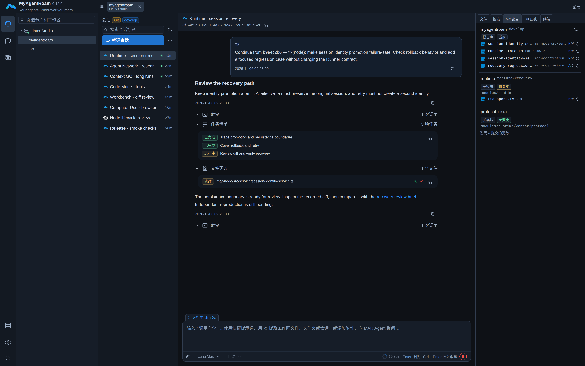
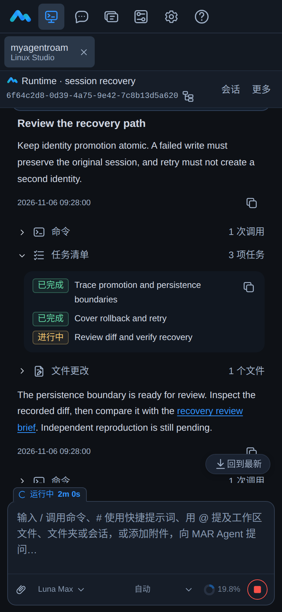
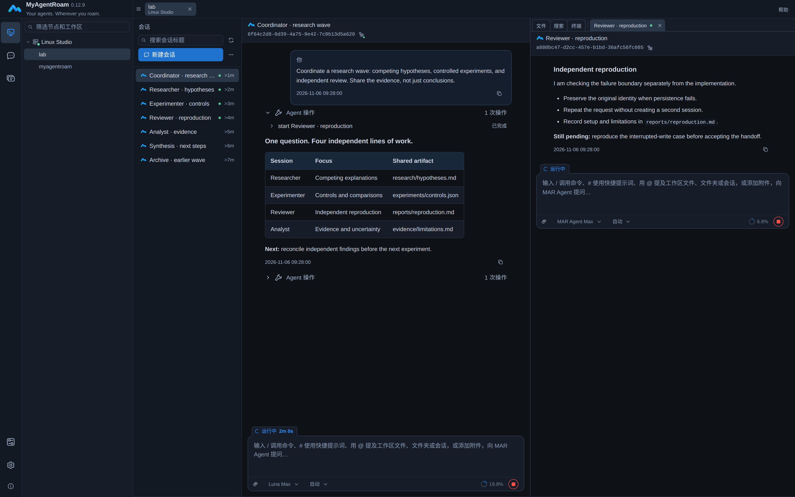
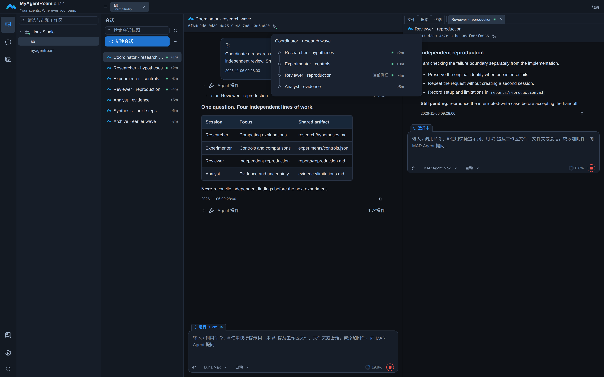
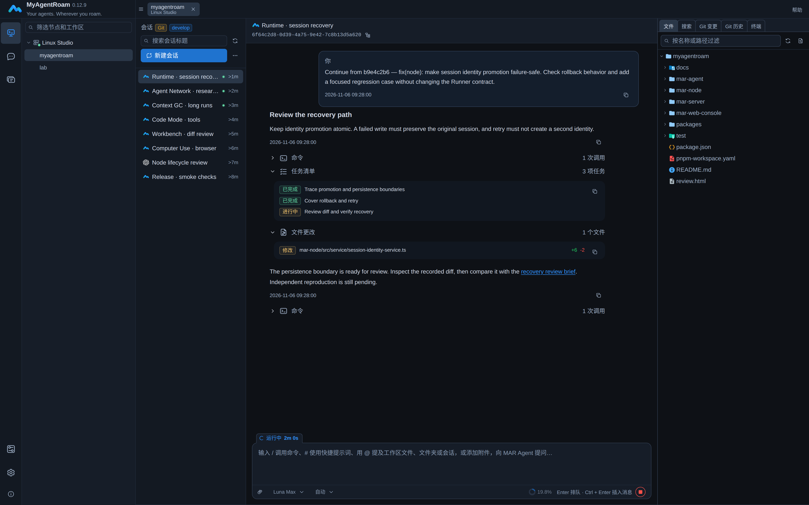
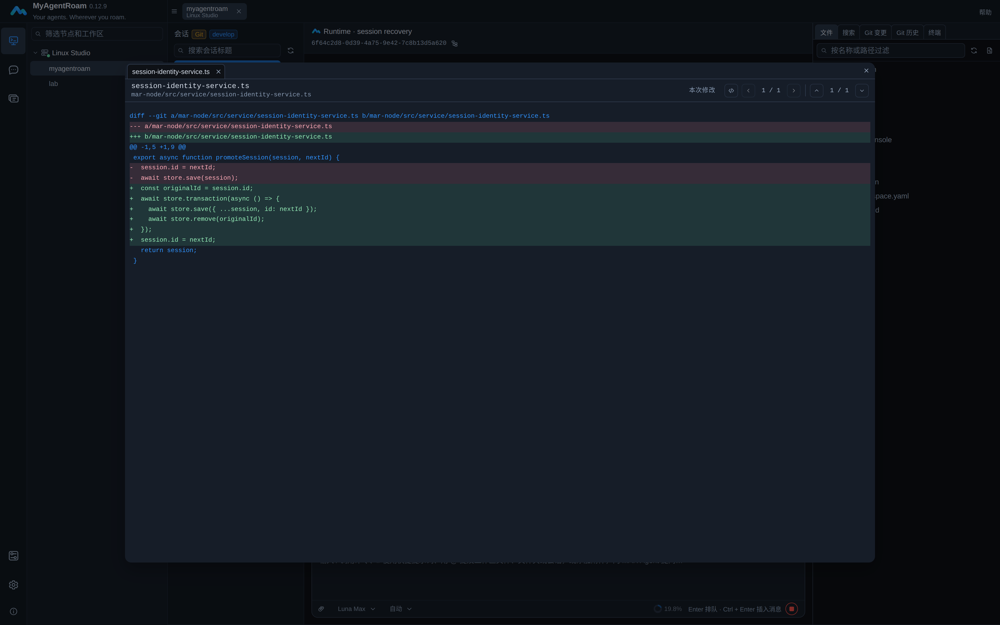
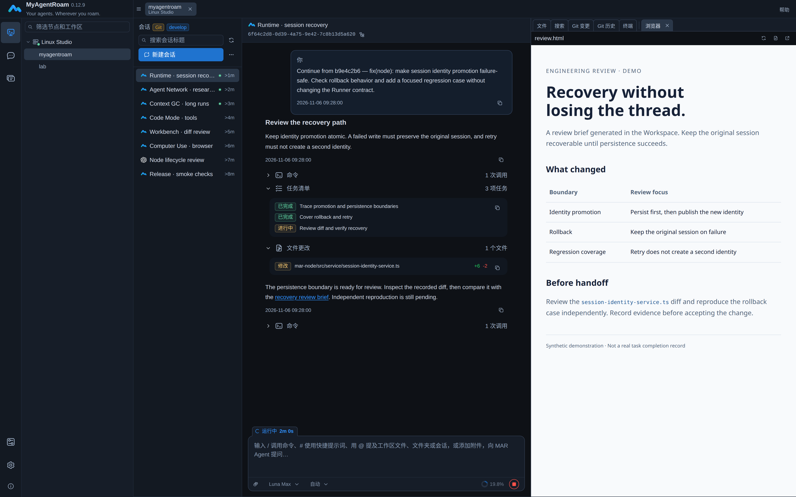

<p align="center">
  
</p>
<h1 align="center">MyAgentRoam</h1>
<p align="center"><strong>Agent First · Work Anywhere</strong></p>
<p align="center">自托管的 Agent 工作台。执行留在工作主机，电脑与手机都能掌握方向。</p>
<p align="center"><strong>MAR Agent · Codex · Claude Code · OpenCode</strong></p>
<p align="center">
  <a href="#开始使用">开始使用</a> ·
  <a href="#agent-first">Agent First</a> ·
  <a href="#work-anywhere">Work Anywhere</a> ·
  <a href="#agent-network">Agent Network</a> ·
  <a href="docs/help/getting-started/overview.md">使用文档</a> ·
  <a href="README.md">English</a>
</p>
<p align="center"><sub>Apache-2.0 公共核心 · 源码可见的产品组合与 EE · <a href="LICENSING.md">准确许可范围</a></sub></p>

<p align="center">
  
</p>



_产品截图来自真实 Web 界面，使用合成演示数据；不是客户会话、真实任务完成记录或性能证据。_

## Agent First

**不是附带 AI 侧栏的 IDE，而是围绕 Agent 执行组织的工作台。**

Agent 是主要执行者。浏览器是你**定义目标、调整执行方向、审阅结果**的地方——项目文件、Git 和终端，就在对话旁边。

人负责目标、约束、关键决策与结果审阅，Agent 使用项目真实的工具和环境推进获授权的工作。**Agent First 不意味着绕过权限，也不意味着省略人的判断。**

> **明确方向 → Agent 执行 → 检查证据 → 调整并继续**

## Work Anywhere

**手机是参与工作的入口，不是另一台需要配置开发环境的电脑。** Agent 在工作 Node 上执行，你通过浏览器查看进展、补充指导、审阅结果。移动端是设计的一部分，而非事后补上的适配：参与工作，不应要求人一直守在执行任务的机器前。

关闭浏览器或切到后台，不会自动停止 Node 上的活动会话。手机适合查看进展、通知、文件和简短回复，复杂 Diff 审查与长时间终端操作仍适合桌面端。Anywhere 需要能够访问自托管 Server，实时操作也要求相关 Node 在线，不代表离线执行。[在移动端继续工作](docs/help/workbench/mobile.md)。

<details>
<summary>查看手机上的会话与执行进展</summary>



</details>

## 不止于单轮问答

<table>
<tr>
<td width="50%"><strong>一次配置，多端接续</strong><br />在自己的 Windows、Linux 或 macOS Node 上准备项目和工具链，从电脑或手机浏览器继续工作。</td>
<td width="50%"><strong>多个 Agent，一个工作台</strong><br />统一查看 MAR Agent、Codex、Claude Code、OpenCode 的历史和实时输出，控制能力遵循各 Runner。</td>
</tr>
<tr>
<td><strong>协作过程看得见</strong><br />独立持久化会话保留各自上下文；通过会话树和主／辅助工作面检查委派、进展与复核结果。</td>
<td><strong>结果可以直接审阅</strong><br />从回复打开文件与本次修改 Diff，在对话旁查看 Git 变更、项目文件或生成的 HTML 页面。</td>
</tr>
<tr>
<td><strong>长任务持续推进</strong><br />MAR Agent 通过 Context GC、后台 Compact、Smart Compaction 与 Code Mode 管理长任务的上下文和工具操作。</td>
<td><strong>调整方向，不必从头开始</strong><br />执行中补充指导，排队后续任务，或用 Goal 和定时任务继续推进；无人值守前先确认权限与执行规则。</td>
</tr>
</table>

### Context GC 与上下文管理

- **Context GC：** 增量回收符合条件的历史上下文，减少长任务每次请求重复携带旧细节。
- **Smart Compaction：** 让 MAR Agent 在合适的工作阶段切换时请求后台整理；固定容量保护仍独立生效。
- **上下文可见：** 查看已报告的上下文用量、GC 次数与回收统计、整理状态及计划，需要时手动 Compact。后台整理期间任务可继续；这些机制不承诺无限、无损的记忆或固定成本节省。

### 持续推进，也让过程可审阅

- **组合工具操作：** 开启 Code Mode 后，MAR Agent 可用 JavaScript 组合获准的工具调用，只返回所需结果，减少中间模型往返。
- **看到执行过程：** 检查上下文用量、计划、工具输出、文件变更与终端活动，而不只依赖 Agent 的最终总结。
- **有意识地继续：** 队列、steer、Goal 和定时任务提供不同推进方式。Goal 会改变队列与权限行为；定时运行会自动批准工具权限请求。只在可信范围内启用。

[上下文与计划](docs/help/workbench/context-and-plan.md) · [Steer、队列与 Goal](docs/help/workbench/composer.md) · [定时会话](docs/help/workbench/sessions.md) · [Code Mode 与工具](docs/help/runners/mar-agent.md)

## Agent Network

**一个问题，多个独立会话，一份共同积累的证据。**

协调者拆分工作，研究会话探索不同解释，独立复核者挑战结果。各会话在同一获授权的工作区内，通过 MAR 已有能力交换消息与共享产物。



_角色由用户组织，围绕工作区协作；Agent Network 不是另一套编排看板。_

<details>
<summary>查看会话关系与运行状态</summary>



</details>

- **独立会话**持久保存各自的历史与父子关系，可跨任务轮次重新接续。
- **会话树与双工作面**让你查看上级、下级及运行状态，在主工作面保留协调会话，在辅助工作面检查另一会话。
- **明确交接**问题、范围和待检查的产物；消息已接收不等于任务已完成。
- **可审阅的过程**保留在共享文件与可见会话历史中；并发写入仍需约定不重叠的范围。

产品中的 MAR Agent 使用原生 **`agent_*` 协作工具**创建、通信、查看、等待和停止获授权的会话；协作关系最多三层（根、子、孙）。其他 Runner 可通过 **marctl** 协同，模型、标题、持久指令和定时任务等管理也按需使用 marctl。会话关系不扩大权限，也不意味着自动任务归属或工作流引擎。[Agent 协作](docs/help/runners/mar-agent.md#子-agent-高级控制) · [marctl 会话管理](docs/help/operations/marctl.md#协同工作区会话)。

## MAR Agent：既能用于工作台，也能独立使用

**Context GC · Smart Compaction · Steer · Code Mode · 子 Agent · Auto · Skill / MCP**

MAR Agent 提供增量 Context GC、会话续接、规划、Skill、MCP 与工具编排。在工作台中使用 Agent Network 协作，也可独立使用 SDK 与 CLI，并按需启用子 Agent 扩展。

SDK、CLI 与工作台使用同一个 MAR Agent 内核。Smart Compaction 是**社区能力**，不是企业专属功能；固定容量保护独立于模型请求的整理机制。[配置 MAR Agent](docs/help/runners/mar-agent.md)。

**Auto 模式**由主模型自行判断工具操作，以尽量低的执行开销减少非预期操作。它不是沙箱，也不是独立安全边界；既有 Host 和操作系统限制仍然适用。

> **一个长会话案例：约 50 小时 · 6,364 次请求 · 75 次整理。** 在这次脱敏 ERP 开发会话中，Context GC 预计使累计上下文输入减少 **20.41%**。这是单案例的观测估算，不是容量、成本节省或质量保证。[核算方法与限制](CONTEXT_GC_CASE_STUDY.md)。

## 从执行过程到可审阅的结果

选择获授权的 Node 与工作区，创建或继续 Agent 会话，在同一工作台使用项目文件、Git 状态和终端。企业共享让获授权成员接手可访问的工作，不必在每个人的电脑上重复配置相同环境。

[了解会话](docs/help/workbench/sessions.md) · [文件](docs/help/workbench/files.md) · [Git 变更](docs/help/workbench/git-changes.md) · [Web Terminal](docs/help/workbench/terminal.md)

<details>
<summary>展开查看：项目文件与工具工作面</summary>



</details>

### 查看本次修改，而不只看最终总结

支持此能力的 MAR Agent Node 会保存 `apply_patch` 每次操作的只读 Diff，显示文件及增删行数；后续修改不会改变已经记录的操作结果。这不是整个任务的净变更，也不覆盖任意 Shell 写入。需要检查当前项目状态时，继续使用 Git 变更与历史。

<details>
<summary>查看文件修改审阅</summary>



</details>

### 在对话旁查看交付产物

文件窗口支持代码与文本、图片、PDF、现代 Office 文档及常见音视频；文本可按 Node 能力编辑、查找和跳转符号。工作区 HTML 可在辅助工作面的浏览器中预览已保存版本，源码草稿仍保留。HTML 可执行脚本，只预览信任的内容；它不是隔离的通用浏览器，也不是完整 IDE。[文件与预览](docs/help/workbench/files.md) · [本次修改](docs/help/workbench/conversation.md#查看本次文件修改)。

<details>
<summary>查看 HTML 产物预览</summary>



</details>

## 开始使用

标准部署使用具备真实主机 UUID 的 Linux 主机、Docker Compose 与 HTTPS 入口。工作 Node 支持 Windows、Linux、macOS，要求 Node.js `>=22.13`；原生 Server 要求 Node.js `>=24.12` 和 MySQL 8.4。

从不含秘密值的 [Compose 环境模板](.env.example)开始，按部署指南填写配置后再启动服务。仅部署 Server 不会安装 Node 执行器。

1. [确认部署前置条件](docs/help/getting-started/prerequisites.md)，然后[部署 Server 与 Web](docs/help/getting-started/server-installation.md)。
2. [首次登录](docs/help/getting-started/first-login.md)，在允许公网访问前修改初始管理员密码。
3. [安装与注册 Node](docs/help/deployment/node-installation.md)，使用产品发行清单指定的精确版本。
4. [登记工作区](docs/help/getting-started/register-workspace.md)，并[配置 MAR Agent](docs/help/runners/mar-agent.md)，或在 Node 服务账号下准备所选外部 Agent。
5. [开始第一次 Agent 会话](docs/help/getting-started/first-agent-session.md)，确认 Node 在线、文件可打开且 Agent 能响应。

部署后访问 `/` 即可进入工作台（`/console`），双语帮助位于 `/docs/`。

### 自托管，也明确数据边界

工作区文件和执行保留在自己的 Node。Server 保存账户、授权与受管模型凭据，查询 API 不返回已保存的模型 API Key 或 OAuth Token。配置的模型请求会把上下文发送给所选服务，因此自托管不等于模型上下文永不离开你的基础设施。请保护 Server、Node、备份及服务账号权限。

[数据与安全](docs/help/concepts/data-and-security.md) · [生产安全检查](docs/help/deployment/security-checklist.md)

<details>
<summary>Browser、Server、Node 与 Agent 如何协作</summary>

```text
浏览器工作台
       │  HTTPS / WebSocket：登录、授权与控制
       ▼
自己的 Server
       ▲  Node 主动建立出站连接
       │
自己的 Windows / Linux / macOS Node
       ├── 真实工作区 · 文件 · Git · 终端
       └── MAR Agent · Codex · Claude Code · OpenCode
```

Server 负责身份、授权与受控中继，Node 负责执行和工作区存储。普通工作区文件与终端可使用 Server 授权的直传数据通道。[组件与数据边界](docs/help/concepts/architecture.md)。

</details>

## 社区与企业

只有一套源码、构建和部署基线。激活改变可用的企业能力，不需要更换程序。

| 能力                                  | 社区版   | 企业激活后            |
| ------------------------------------- | -------- | --------------------- |
| 工作区会话、文件、Git、终端与个人配置 | 可用     | 可用                  |
| 组织、多用户管理、角色与共享资源授权  | 需要激活 | 在 License 范围内可用 |
| 企业 SSO 与操作审计                   | 需要激活 | 在 License 范围内可用 |

两种状态都要求有效的真实主机 UUID。企业 License 到期后沿用管理冻结行为，不删除用户数据，也不重置为全新的社区状态。[激活与 License 管理](docs/help/administration/license.md)。

## 开发与贡献

本项目采用维护者主导的 AI 辅助开发方式，优先接受问题反馈和功能建议；PR 可能作为维护者重新实现的参考，而非直接合并。协作方式、原因、本地环境与验证要求见 [CONTRIBUTING.md](CONTRIBUTING.md)。

## 帮助与联系

- 使用与排障：[公开帮助](docs/help/getting-started/overview.md)。
- 部署与产品支持：**achaosxyz@gmail.com**。不要发送密码、Token、私钥或未脱敏日志。
- EE 作者与许可联系：**aCHAOS（achaosxyz@gmail.com）**。

## 许可证

独立公共核心采用 [Apache-2.0](LICENSE)。EE 与产品组合采用 [MyAgentRoam 企业源码可见许可证 1.0](ee/LICENSE)（`MAR-ESAL-1.0`），不属于 OSI 认可的开源许可证。准确范围见 [LICENSING.md](LICENSING.md)，归属声明见 [NOTICE](NOTICE)。

社区功能允许免费内部自用，包括公司内部商业工作。企业激活**不授予**含 EE 产品的二次分发、转售、对外托管、SaaS/API 服务、OEM、白标或捆绑交付权。独立许可的公共核心及第三方组件保留各自权利与条款。

Node 使用的 `@myagentroam/binaries` 包包含 GPL-2.0-or-later 授权的 Universal Ctags。许可文本、声明及对应源码位于该包的 `vendor/ctags/`；同时请核对所用发行版附带的第三方许可声明。
